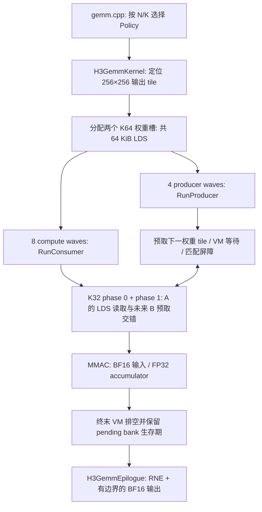

# v08：按 CK-Tile 职责组织的 gfx936 GEMM

v08 把 v07 已验证的专用生产消费者流水拆成有明确接口的 Problem、Policy、Pipeline、Epilogue、Kernel 和 Dispatch。它实际使用 CK 的 `TileGemmShape2Groups` 推导 tile 和 producer/consumer wave 数，使用 CK 数据类型、MMAC warp primitive 和 HCU buffer 原语，保留 gfx936 的专用非对称流水；并未强行改回 CK 现有的对称通用 GEMM pipeline。

性能与正确性验收见 [RESULTS.md](RESULTS.md)，原始数据见 [evidence/](evidence/)。v07 是不可变的历史性能参考，文件未被重构覆盖。

## 代码从哪里读

| 层 | 文件 | 主要职责 |
|---|---|---|
| Problem | [gemm_problem.hpp](src/gemm_problem.hpp) | BF16/FP32 类型、256×256 输出 tile、K64/K32、8+4 waves 等静态契约 |
| Policy | [gemm_policy.hpp](src/gemm_policy.hpp) | LDS 布局、权重搬运策略、raw/structured 激活访问、编译期索引类型 |
| Pipeline | [gemm_pipeline.hpp](src/gemm_pipeline.hpp) | producer 与 consumer、K32 双 bank、预取点、两 phase、匹配屏障、终末排空 |
| Epilogue | [gemm_epilogue.hpp](src/gemm_epilogue.hpp) | FP32→BF16 RNE、token 尾部 bounds-checked 写回 |
| Kernel / Partitioner | [gemm_kernel.hpp](src/gemm_kernel.hpp) | CTA 遍历、64 KiB LDS、wave 角色分配、组合 pipeline 和 epilogue、主机参数检查 |
| Dispatch | [gemm.cpp](src/gemm.cpp) | 公共 C ABI 和原有精确 N/K 分发 |
| gfx936 arch | [gfx936.hpp](src/arch/gfx936.hpp) | wait/barrier、priority、buffer descriptor、底层 load/store、BF16 舍入 |

没有 `H3_*` 实验宏、函数体内 include、重复包含 `.cpp`、宏重命名符号或未采用实验的分支。保留的 `CK_TILE_FLOAT_TO_BFLOAT16_DEFAULT` 是原实验的 CK 数值配置，保持为 0。

`H3GemmKernel<Partitioner, Pipeline, Epilogue>` 与 CK-Tile 的组合方式一致。特殊的 8 compute + 4 producer 调度由私有 pipeline 实现，通用 CK include 和 `03_gemm` 不修改。读取性能敏感代码时，先看 `RunProducer()` 和 `RunConsumer()`，再查 Policy 的地址与加载方法。

## 静态策略

| Policy | 激活 B | 权重 A 搬运 | 统一入口选择 |
|---|---|---|---|
| `RawPolicy` | raw buffer + 公共 K rebase | 原逐 tile producer | 非目标尺寸 fallback |
| `StructuredPolicy` | K32 structured descriptor、bit62 cache swizzle | 原逐 tile producer | QKV / FC1 |
| `ProducerPolicy` | 同上 | 固定槽双 tile + A scalar offset | FC2 / attention out projection |

三种策略都有 4 个 producer waves。`PairedProducer=true` 指已经验证的双 tile/soffset 组合，而不是“是否存在 producer”。策略在 C++ 模板实例化时确定，计算循环没有运行时策略判断。

两个索引类型描述相同的非负 LDS 坐标：普通策略沿用 signed 表达式；paired producer 使用 unsigned 表达式明确非负范围。这是固定 DTK 编译器下为保留指令调度而验证的选择，不改变逻辑矩阵布局。与“所有策略统一改 unsigned”相比，分别保留更合适的编译形式避免了某些 shape 的回退，详见结果报告。

## 一次执行如何走



每个 compute wave 负责不同的 32 个 token、同一组 256 个 feature。所有 compute waves 都执行两个 K32 phase；两组各 4 个 wave 的区别是屏障放在数学计算之前还是之后。权重的必要 LDS 读取完成后，producer 才能覆盖旧槽，剩余计算使用各 wave 私有 VGPR。

不要删除 terminal bank 的生存期约束、把 checked token 位移移到 scalar offset，或把两组屏障改成对称位置。这些属于正确性及流水协议，不是历史实验残留。

## 构建、测试与 ABI

从 `04_gemm` 目录，在原 `ck_yyc` / gfx936 / DTK 环境执行：

```bash
python3 build.py --version v08_ck_tile --ck-root /workspace/composable_kernel
HIP_VISIBLE_DEVICES=4 OMP_NUM_THREADS=4 python3 bench.py \
  --versions v07_struct32_330t,v08_ck_tile --tag my_v07_v08_comparison
```

`bench.py` 的比较依赖已构建的 v07；新环境先用同样命令 `build.py --version v07_struct32_330t` 构建参考。根目录默认版本保留既有归档行为，使用 v08 时显式传版本参数。

独立的两个直接入口也可用统一工具构建：

```bash
python3 build.py --version v08_ck_tile --variant structured --ck-root /workspace/composable_kernel
python3 build.py --version v08_ck_tile --variant producer --ck-root /workspace/composable_kernel
HIP_VISIBLE_DEVICES=4 OMP_NUM_THREADS=4 python3 bench.py \
  --versions v08_ck_tile__producer --m 4096 --shapes square4096 --tag my_square4096
```

默认库还直接导出 `h3_gemm_structured` 和 `h3_gemm_producer`，方便独立算子测试；`h3_gemm` 的形状分发与 v07 一致。所有函数签名均为：

```cpp
int h3_gemm(const void* input, const void* weight, void* output,
            int m, int n, int k, hipStream_t stream);
```

公共计算为 `Y[M,N] = X[M,K] @ W[N,K].T`，连续 BF16 输入/输出，FP32 累加，无 bias。输入和权重基址需 16-byte 对齐，N 为 256 的倍数、K 为 64 的倍数，M 支持 token 尾部。structured 直接入口要求 K<8192；统一入口对非目标 N/K 继续使用 raw fallback，不缩小 v07 的原有调用域。

完整审计命令：

```bash
# 先构建 v07 default / structured / producer 和 v08 default。
HIP_VISIBLE_DEVICES=4 OMP_NUM_THREADS=4 python3 versions/v08_ck_tile/tests/audit.py \
  --tag my_v08_correctness_audit
```

审计包含同输入 v07 逐位对照、三种子、三次重复、token 尾部、奇数 K64 tile、2-byte 输出偏移、raw K8192/16384、4096³、Inf/NaN/非正规数/有符号零以及主机拒绝接口检查。计时结果不能用审计运行中的耗时替代。
